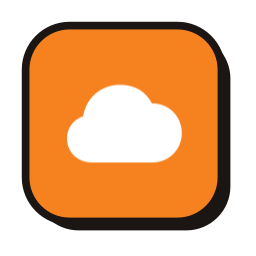

# Overmind

**Know before the free tier says no.** A macOS menu bar app that watches a Cloudflare
account's usage and bill: the limit closest to running out, a warning before it does,
the query or deploy behind it, and what the month costs — read with a read-only token.

ClaudeBar's and AgentNexus's sibling: same design method, same Pop theme. AgentNexus is named for the
Protoss Nexus; Overmind for the Zerg mind that senses the whole swarm — here, every Worker,
database and bucket on the account at once.


## Install

```bash
brew install --cask tddworks/tap/overmind
```

Or download the DMG from [Releases](https://github.com/tddworks/Overmind/releases), open it and drag
Overmind to Applications. It updates itself (Settings → General).

Or build from source (macOS 15+, Xcode, [Tuist](https://tuist.dev)):

```bash
tuist install && tuist generate
xcodebuild build -workspace Overmind.xcworkspace -scheme Overmind -destination 'platform=macOS,arch=arm64' -derivedDataPath .build/dd
open .build/dd/Build/Products/Debug/Overmind.app
```

Try it without an account: `OVERMIND_DEMO=1 .build/dd/Build/Products/Debug/Overmind.app/Contents/MacOS/Overmind`.

## First run

1. [Create an API token](https://dash.cloudflare.com/profile/api-tokens) with **read** access to
   **Account Analytics** and **Workers Scripts**, and **Billing** if you want the plan and invoices.
2. Click **☁** in the menu bar, paste the token, **Connect**. It is kept in your Keychain.
3. The menu bar shows the limit closest to running out (**D1 18%**). Overmind reads every 5 minutes
   and after the Mac wakes, and warns at 50%, 75% and 90%, or early when today's pace would cross 90%.
4. **⚙ → Settings…** changes how often it reads, the warnings, starting at login and updates
   ([features](docs/features/)).

## What it watches

| Service | Limits | Tab |
|---|---|---|
| Workers | requests, CPU per invocation (Free) or CPU time (Paid) | requests per hour, invocations by outcome, cron runs, deployments |
| D1 | rows read, rows written, storage | rows read per day and hour, top queries |

Plans: Free and Workers Paid; the Bill tab prices this month on both. Other Cloudflare products
are one JSON file each → [ENGINE_DESIGN](docs/architecture/ENGINE_DESIGN.md).

Overmind only reads: no call it makes can change your account.

## Docs

[The design](docs/architecture/ARCHITECTURE.md) · [features](docs/features/) · [releasing](docs/release/RELEASE_SETUP.md) · [status](docs/status.md) · [for agents](AGENTS.md)
